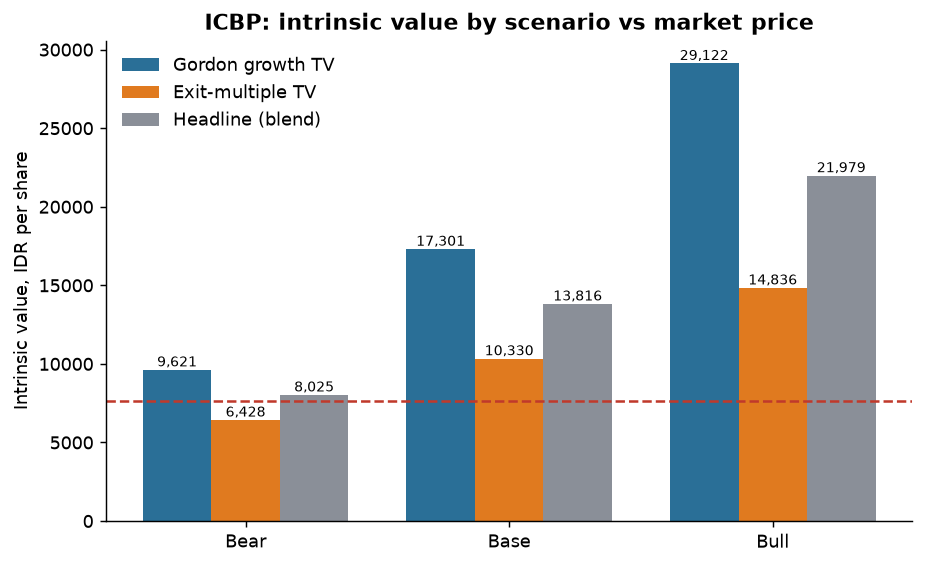
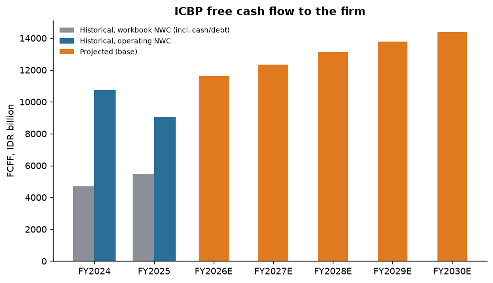
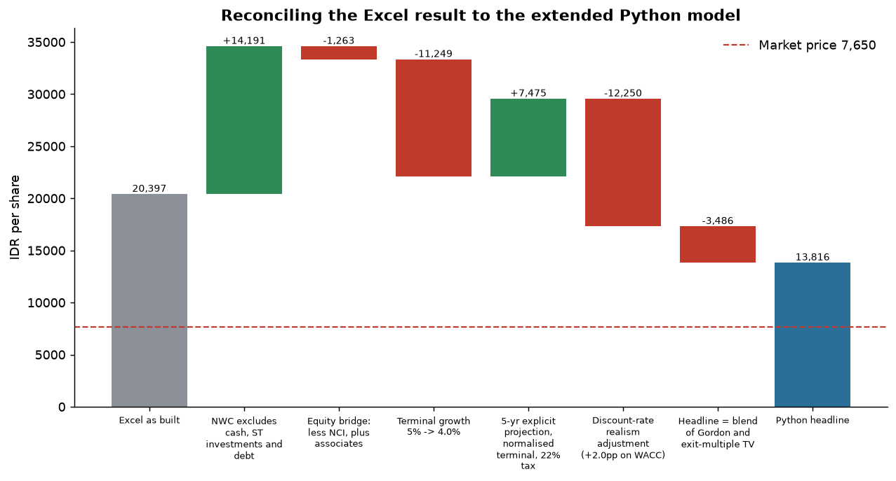
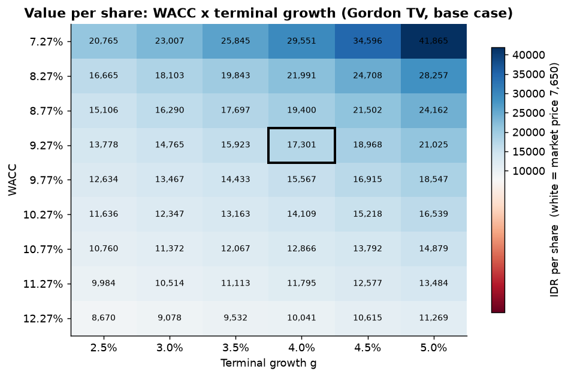
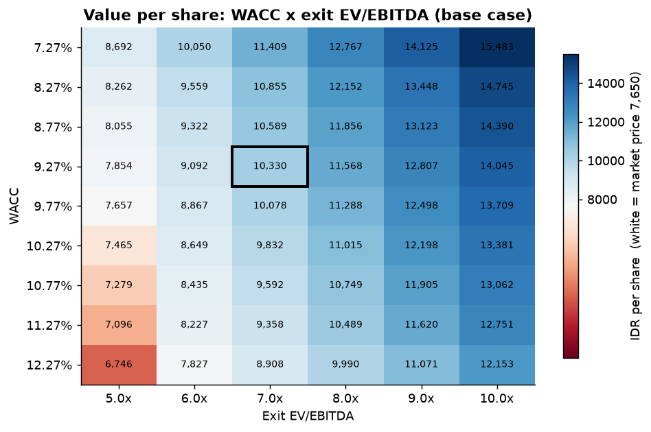
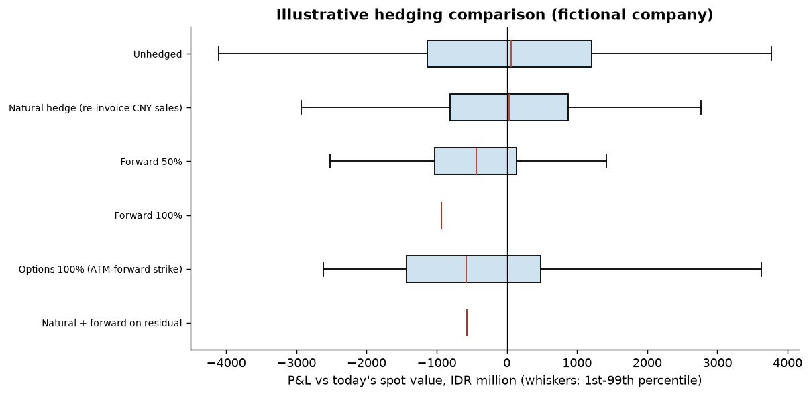

# ICBP DCF Valuation and FX Exposure Study

> **Educational analysis, not investment advice.** Nothing in this repository is a recommendation to buy, sell or hold any security.

*Originally a university Financial Management assignment; rebuilt and extended in Python.*

English | [Bahasa Indonesia](README.id.md)

## Purpose

Value **PT Indofood CBP Sukses Makmur Tbk (IDX: ICBP)** with a discounted-cash-flow (DCF) model that is transparent,
reproducible and testable, and answer a question a spreadsheet cannot easily answer: *how much of the result depends on
modelling choices rather than on the company?*

The repository contains two pieces:

1. **ICBP DCF** (main): FCFF, WACC, terminal value (Gordon growth and exit multiple), per-share value, WACC x g heat maps,
   bull/base/bear scenarios, a reverse DCF, and a quantified audit of the original Excel workbook.
2. **FX exposure study** (short): transaction exposure, VaR, and natural hedge vs forward vs option comparison on a
   **fictional company with illustrative numbers**.

## Headline results

Valuation date 31 Dec 2025 (last audited fiscal year). Market price **IDR 7,650** as recorded in the course workbook for
May 2026 (not refreshed; see Limitations). Shares outstanding 11,662 million. All figures are produced by
`python -m icbp_valuation` and stored in `reports/tables/`.

| | Value per share (IDR) | vs IDR 7,650 |
|---|---:|---:|
| Original Excel workbook, as built | 20,397 | +167% |
| **Extended model, base** (headline = 50/50 blend of Gordon and exit multiple) | **13,816** | **+81%** |
| Extended model, bear | 8,025 | +5% |
| Extended model, bull | 21,979 | +187% |

Terminal-value method matters a lot:

| Scenario | WACC | g | Exit EV/EBITDA | Gordon (IDR/share) | Exit multiple (IDR/share) | Blend |
|---|---:|---:|---:|---:|---:|---:|
| Bear | 10.3% | 3.0% | 5.5x | 9,621 | 6,428 | 8,025 |
| Base | 9.3% | 4.0% | 7.0x | 17,301 | 10,330 | 13,816 |
| Bull | 8.3% | 4.5% | 8.5x | 29,122 | 14,836 | 21,979 |



**How to read this.**

- The market-implied EV/EBITDA (market cap + debt - cash + minority interest - associates, over FY2025 EBITDA) is
  **6.75x**. The Gordon terminal value in the base case equals **12.6x** EBITDA, which is why the Gordon value sits far
  above the exit-multiple value.
- A **reverse DCF** shows that, holding the base operating assumptions, the market price corresponds to a WACC of about
  **14.2%** (Gordon) to **15.4%** (exit multiple), against 9.3% in the base case. Either the market expects much weaker
  growth/margins, demands a much higher return, or this simple model is too generous. The honest conclusion is a wide range,
  not a point target.
- Even the bear case (lower growth, 20% EBIT margin, WACC 10.3%, g 3%) is roughly at the market price, so the model gives
  no evidence of a large downside in its own framework, but that statement is only as good as the inputs.

## Methodology

| Step | What the model does | Code |
|---|---|---|
| Inputs | FY2023-FY2025 income statement, balance sheet and cash-flow lines (IDR million) | `data/icbp_financials.yaml` |
| Assumptions | Every driver, rate and scenario in one file | `assumptions.yaml` |
| Projection | FY2026E-FY2030E revenue, EBIT, NOPAT, D&A, capex, change in operating NWC | `dcf.project_fcff` |
| FCFF | NOPAT + D&A - capex - change in NWC | `dcf.fcff` |
| WACC | CAPM cost of equity; cost of debt = interest expense / interest-bearing debt; market-cap and book-debt weights | `wacc.py` |
| Terminal value | Gordon growth on a growth-consistent FCFF, and EV/EBITDA exit multiple | `dcf.gordon_terminal_value`, `dcf.exit_multiple_terminal_value` |
| Equity bridge | EV - net debt - non-controlling interest + associates (book values) | `dcf.equity_bridge` |
| Scenarios and sensitivity | Bull/base/bear; WACC x g and WACC x multiple grids; reverse DCF | `dcf.py` |

Driver anchors, computed from the historicals: revenue CAGR FY23-25 4.99%; EBIT margin 21.8% / 22.7% / 21.2%;
operating NWC 7.6% / 9.1% / 10.8% of revenue; capex 2.7% / 3.0% / 4.9% of revenue; D&A about 2.5% of revenue. The base
case uses 5.0% -> 4.0% revenue growth, a 21.5% EBIT margin, 22% tax, and terminal growth equal to the final-year growth (4.0%).
**Scenario drivers are analyst assumptions for an educational exercise, not forecasts.**

CAPM inputs are carried over unchanged from the workbook (risk-free 4.75%, beta 0.60, ERP 7.5%; WACC 7.26%). The base case
then adds a **+2.0 pp judgement** to WACC (bull +1.0 pp, bear +3.0 pp) because the risk-free proxy is a policy rate and
beta 0.60 is low; this is explicit and editable in `assumptions.yaml`.



## Verification against the Excel workbook

`replicate_workbook()` re-implements the *FCFF & DCF* sheet exactly as built, and `verify.compare()` checks 26 outputs
(NOPAT, change in NWC and FCFF for three years, Ke, Kd, weights, WACC, firm value, equity value, value per share, ...)
against the values Excel computed (`data/excel_reference.json`, with cell addresses).

**Result: 26 of 26 match; worst relative difference 3e-10** (Excel stores about 15 significant digits). The workbook's
IDR 20,396.74 per share is therefore arithmetically correct *given its own assumptions*. The differences from the extended
model come from modelling choices, found in the audit below.

## Findings from auditing the Excel workbook

Recomputed by `icbp_valuation.audit` (full text in `reports/tables/excel_audit_findings.csv`):

| # | Finding | Effect |
|---|---|---|
| 1 | The "NWC" used for the change in working capital is total current assets minus total current liabilities, so it includes **cash, short-term investments and short-term debt**. FY2025 change = 5.09 tn vs 1.53 tn with operating NWC. | FY2025 FCFF is **understated**: 5.47 tn -> 9.04 tn. Worth about +IDR 14,200/share at the workbook's other settings. |
| 2 | FY2023 change in NWC subtracts a **hard-coded, unsourced FY2022 NWC (21,036,430)** inside a formula. | FY2023 FCFF is not reproducible. |
| 3 | Equity value = EV - net debt; **minority interest (22.2 tn book) is not deducted and associates (7.4 tn) are not added**. | -IDR 1,263/share at the workbook's EV. |
| 4 | Terminal growth **5.0% exceeds the 4.75% risk-free proxy**; WACC - g is only 2.26 pp, so EV is 44x next-year FCFF. | +0.5 pp on WACC alone cuts EV by 18%. |
| 5 | Risk-free rate is the BI policy rate, not a long-dated government yield. Cost of equity 9.25% is low for a rupiah stream. | WACC probably too low. |
| 6 | **Balance sheet does not balance** in FY2023 (gap 100) and FY2024 (gap 75,521 million). | Transcription error in one line item. |
| 7 | DOL is defined as gross profit / EBIT; the workbook's own verification rows give DOL -1.12 and DFL -8.04 versus 1.66 and 1.16 from the formulas. FY2025 EPS growth was driven by associates, not operating leverage. | Leverage conclusions not supported. |
| 8 | FX sheet scales volatility by sqrt(365) (not trading days), sums stand-alone VaRs without correlation, and types in volatilities. | P&L-at-risk 73% of net income falls to 61% with sqrt(252). |
| 9 | Hard-coded recommendation text disagrees with cells (e.g. "Target DCF: IDR 12,000+" vs the computed 20,397; label "9.23x" vs input 9.67x). | Presentation. |
| 10 | Operating cash flow adds D&A to an adjustment line labelled as already including D&A: possible double count. | Flagged, **not confirmed**; needs the filing. |

### Reconciliation: Excel -> extended model



The workbook's 20,397 is the net of a large *conservative* error (NWC definition, +14,191) and large *aggressive* choices
(g = 5%, thin WACC). Fixing only the conservative error without the aggressive ones would give a more extreme number, and
vice versa. Order of steps is a presentation choice; effects interact.

## Sensitivity





Each heat map is centred on the base case (boxed) and coloured around the market price (white). With Gordon growth, base-case
value ranges from about IDR 8,700 (WACC 12.3%, g 2.5%) to about IDR 41,900 (WACC 7.3%, the workbook's WACC, with g 5%) - nearly a 5x spread.
With an exit multiple the range is narrower: about IDR 6,700 to 15,500 over the same WACC range and 5x-10x.

## FX exposure study (illustrative)

`notebooks/fx_exposure_illustrative.ipynb` and `src/icbp_valuation/fx_exposure.py`.

The course assignment's FX case was a fictional company supplied with the module, so it is **not reused**. The method is
rebuilt on a **fictional company with invented, illustrative numbers** (`fx_case` in `assumptions.yaml`; not market data).
It covers net monetary positions, variance-covariance VaR (diversified vs summed), covered-interest-parity forwards,
Garman-Kohlhagen options, and a Monte Carlo comparison of six hedging strategies over six months. Key illustrative result:
a 100% forward removes variance but locks in the forward points (about IDR 0.9 bn net expected cost on a book that is IDR 54.6 bn
short and IDR 22.1 bn long foreign currency, because IDR rates exceed foreign rates), options keep the upside at an up-front premium, and re-invoicing sales in
the payable currency reduces risk by about 27% at no instrument cost.



## Limitations

- **Data provenance.** Inputs are transcribed from a course workbook whose stated sources are ICBP annual reports / IDX
  filings, S&P Global MI (via stockanalysis.com) and Yahoo Finance. They have **not** been re-verified against the filings,
  and the FY2023/FY2024 balance sheets do not balance. Check against the filings before relying on any number.
- **Stale price.** IDR 7,650 is the price recorded for May 2026; the valuation date is 31 Dec 2025 with no roll-forward.
- **Discount rate.** CAPM inputs are carried over from the workbook; the +2.0 pp adjustment and all scenario drivers are judgements.
- **Equity bridge** uses book values for minority interest and associates and ignores leases, pensions and minority put options.
- **Terminal value dominates** (about 78% of base-case EV under Gordon), and the Gordon and exit-multiple methods disagree materially.
- Single company, no peer regression, no management guidance, no macro or FX linkage in the DCF.
- FX study is fully fictional: zero-drift lognormal rates, constant correlations, no hedge accounting, bank spreads or credit lines.

## How to run

```bash
git clone <this repo> && cd portfolio-icbp-valuation
python -m venv .venv
# Windows: .venv\Scripts\activate      macOS/Linux: source .venv/bin/activate
pip install -r requirements.txt
pip install -e .

python -m icbp_valuation                 # verification, scenarios, figures and tables
pytest -q                                # 35 tests
python scripts/build_notebooks.py        # rebuild and execute both notebooks
```

Change any assumption in `assumptions.yaml` (growth, margins, WACC adjustment, terminal growth, exit multiple,
scenarios, sensitivity grids, FX case) and re-run. The original workbook is not included; `scripts/extract_from_workbook.py`
regenerates `data/` from it if you have a copy.

## Repository layout

```
assumptions.yaml            all modelling assumptions (single source of truth)
data/                       icbp_financials.yaml, excel_reference.json
src/icbp_valuation/         config, wacc, dcf, verify, audit, fx_exposure, plots, CLI
tests/                      35 pytest tests (WACC, PV, TV, sensitivity consistency, Excel replication, FX)
notebooks/                  icbp_dcf.ipynb (executed), fx_exposure_illustrative.ipynb (executed)
reports/figures, tables     generated outputs
scripts/                    workbook extraction, notebook builder
```

## AI assistance disclosure

This repository was rebuilt from the author's original course workbook with substantial help from an AI coding assistant
(Claude, by Anthropic, used through Claude Code). The assistant wrote most of the Python code, tests, notebooks and
documentation, performed the workbook audit, and proposed the extended-model drivers (growth, margins, the +2.0 pp WACC
adjustment, exit multiples) and the fictional FX case. The original assignment, the choice of company and the source data
come from the author. Every number in this README is generated by code in this repository and can be regenerated; the
judgemental assumptions in `assumptions.yaml` should be reviewed and owned by whoever uses the model.

## Disclaimer

**Educational analysis, not investment advice.** The author is not a licensed financial adviser. Figures may contain
errors, and market data is not current.

## License

MIT, see [LICENSE](LICENSE).
